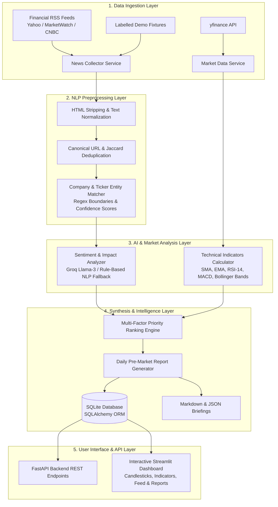

# AI-Powered Stock Market Insights Bot 📈🤖

An intelligent, multi-source financial intelligence and decision-support platform designed to collect financial news, perform NLP and LLM event impact analysis, compute technical market indicators, and generate automated pre-market daily briefings for investors and students before trading hours begin.

[](https://www.python.org/)
[](https://fastapi.tiangolo.com/)
[](https://streamlit.io/)
[](https://www.sqlite.org/)
[]()
[]()

---

## 👥 Academic Project Information

- **Institution**: Department of Computer Science and Engineering
- **Supervisor**: Ms. Diana Mathew, Assistant Professor, Department of CSE
- **Student Team**:
  - **Abel Louis Fernandez** (B23CS2103)
  - **Akshay P. Benjamin** (B23CS2112)
  - **Aparna S.** (B23CS2116)
  - **Goutham C.S.** (B23CS2130)

### 🌍 United Nations Sustainable Development Goals (SDGs)
- **SDG 8: Decent Work and Economic Growth**: Provides timely, accessible financial insights that support informed decision-making and economic participation.
- **SDG 9: Industry, Innovation and Infrastructure**: Applies cutting-edge Generative AI, NLP, and automated data pipelines to create an innovative financial intelligence platform.
- **SDG 16: Peace, Justice and Strong Institutions**: Promotes financial transparency by transforming complex corporate news into clear, verifiable insights with rigorous source attribution.
- **SDG 4: Quality Education**: Fosters financial literacy by helping students, investors, and analysts understand market mechanics and the relationship between news sentiment and asset prices.

---

## 🏗️ Architecture & Data Flow



---

## ✨ Features Implemented

1. **Multi-Source News Ingestion**:
   - Automated polling across public financial syndication feeds (Yahoo Finance, MarketWatch, CNBC, Google News).
   - High-quality, curated demo fixtures for completely offline, zero-credential academic execution.
   - Built-in HTTP error handling, retry limits, and header identification.

2. **Text Normalization & Deduplication**:
   - Strips tracking query parameters (`utm_*`, `fbclid`, `ref`) into canonical URLs.
   - Jaccard similarity index to remove duplicate syndicated stories across news wires.
   - Robust timestamp conversion into standard ISO-8601 UTC format.

3. **High-Precision Ticker Matching**:
   - Strict word-boundary matching and dollar-tag regex (`$AAPL`, `(TSLA)`, `NVIDIA Corporation`).
   - Filters out ambiguous English words (`A`, `ON`, `CAN`, `IT`, `SO`) to prevent false positive stock associations.
   - Assigns audit confidence scores to each entity match.

4. **Structured Sentiment & Impact Analysis**:
   - Supports **Groq Llama 3.1** structured JSON output or high-precision financial dictionary fallback (inspired by the Loughran-McDonald financial lexicon).
   - Extracts:
     - Short summary
     - Sentiment label & numerical polarity score (-1.0 to +1.0)
     - Event category (Earnings, Products, Regulatory/Legal, M&A, Macro)
     - Business operational implications
     - Positive and negative stock-market implications
     - Verifiable quote/evidence directly from the article
     - Confidence score with transparent reasoning
     - Explicit handling for insufficient information

5. **Quantitative Market Data & Technical Indicators**:
   - Historical OHLCV candle retrieval using `yfinance`.
   - Technical indicators computed via NumPy & Pandas:
     - Simple Moving Averages: SMA-20, SMA-50
     - Exponential Moving Averages: EMA-12, EMA-26
     - Relative Strength Index: RSI-14
     - Moving Average Convergence Divergence: MACD Line, Signal Line, Histogram
     - Bollinger Bands (20-period, 2-std)
     - Volume 20-period Moving Average
   - Technical bias summaries (e.g. Overbought, Oversold, Bullish Momentum).

6. **Multi-Factor Priority Scoring & Ranking**:
   - Computes a transparent 0–10 priority score:
     $$\text{Priority} = 4.0 \times |\text{Sentiment}| + 3.0 \times \text{Event Weight} + 1.5 \times \text{Divergence Bonus} + 1.5 \times \text{Volume Factor}$$
   - Identifies technical divergences (e.g., positive news event colliding with an oversold RSI-14).
   - Outlines material risks and selection rationale for each stock to watch.

7. **Pre-Market Intelligence Briefing**:
   - Generates daily reports with macro market tone, stocks to watch, high-impact events, and risk factors.
   - Exports reports automatically to disk as both `.md` (Markdown) and `.json`.
   - Fully auditable with source references and timestamp freshness warnings.

8. **Interactive Streamlit Dashboard**:
   - **Overview**: Top metrics, priority-ranked watchlist, and recent high-impact events.
   - **Stock Deep Dive**: Interactive Plotly candlestick charts, 20-day SMA, Bollinger Bands, and RSI subplots.
   - **News & AI Impact Feed**: Filter by sentiment (Bullish/Bearish/Neutral), ticker, or keyword search.
   - **Pre-Market Report View**: View and download daily briefings in Markdown or JSON with one click.
   - **Pipeline Execution**: Manual one-click trigger to refresh data and re-run analysis.

9. **FastAPI Backend REST API**:
   - Fully documented OpenAPI (`/docs`) with endpoints for health, companies, news, market data, analyses, and report generation.

---

## 🛠️ Technology Stack & Rationale

| Component | Technology | Rationale |
| :--- | :--- | :--- |
| **Backend Framework** | FastAPI | High-performance asynchronous REST API with automatic Pydantic documentation |
| **Validation & Schemas** | Pydantic V2 | Type safety, rigorous validation, and structured output parsing |
| **Persistence** | SQLite + SQLAlchemy 2.0 | Zero-configuration local database, ACID compliance, and relational queries |
| **News Collection** | Requests + BeautifulSoup + Feedparser | Standard, robust RSS parsing and HTML entity stripping |
| **Market Data** | yfinance | Free and open access to historical daily candles and fast ticker quotes |
| **Technical Analysis** | NumPy + Pandas | Fast vectorized numerical calculations of RSI, MACD, and moving averages |
| **NLP & LLM** | Groq (Llama-3.1) / Financial Lexicon Fallback | Structured JSON generation with instant rule-based fallback when offline |
| **Frontend Dashboard**| Streamlit + Plotly | Intuitive, interactive dashboards with candlestick charting and responsive widgets |
| **Testing** | Pytest | Industry-standard test runner with automated mocks and integration fixtures |

---

## 🚀 Setup & Execution Guide (Windows)

### 1. Prerequisites
- **Python**: Version 3.10, 3.11, or 3.12 installed on your system.
- **Git**: Installed and added to PATH.

### 2. Clone the Repository
```powershell
git clone https://github.com/Aparna2116/Stock-Market-Insights-Bot.git
cd Stock-Market-Insights-Bot
```

### 3. Create and Activate Virtual Environment
```powershell
python -m venv venv
.\venv\Scripts\Activate.ps1
```

### 4. Install Dependencies
```powershell
pip install -r requirements.txt
```

### 5. Configure Environment Variables
Copy `.env.example` to `.env`:
```powershell
Copy-Item .env.example .env
```

Configuration variables available in `.env`:
```ini
# Set to True for 100% offline development using realistic fixtures
DEMO_MODE=True

# Database URL
DATABASE_URL=sqlite:///./data/stock_insights.db

# Optional LLM API Key (leave empty for instant built-in NLP engine)
LLM_PROVIDER=rule_based
GROQ_API_KEY=
GROQ_MODEL=llama-3.1-70b-versatile

# Market Settings
DEFAULT_EXCHANGE=NASDAQ
DEFAULT_TIMEZONE=America/New_York
```

### 6. Initialize Database
Initialize the SQLite tables:
```powershell
python -c "from app.database import init_db; init_db()"
```

---

## 🖥️ Running the Application

### Option A: Launch Interactive Dashboard (Streamlit)
```powershell
streamlit run app/dashboard/streamlit_app.py
```
> Open your browser at: **`http://localhost:8501`**

### Option B: Launch FastAPI Backend Server
```powershell
uvicorn app.main:app --host 127.0.0.1 --port 8000 --reload
```
> Open your browser at:
> - API Root: **`http://127.0.0.1:8000/`**
> - Swagger UI: **`http://127.0.0.1:8000/docs`**
> - Health Check: **`http://127.0.0.1:8000/api/health`**

### Option C: Run Pre-Market Pipeline Directly via Terminal
```powershell
python -c "from app.services.pipeline_orchestrator import PipelineOrchestrator; PipelineOrchestrator(demo_mode=True).run_pipeline()"
```

### Option D: Run Pre-Market Timezone Scheduler
```powershell
python -m app.services.scheduler_service
```
*(Monitors market opening hours and automatically triggers briefings 30 minutes before market open.)*

---

## 🧪 Automated Testing

Run the full pytest test suite:
```powershell
pytest -v
```

### Test Coverage Highlights
- `tests/test_preprocessor.py`: Text cleaning, HTML tag removal, URL canonicalization, and Jaccard deduplication.
- `tests/test_company_matcher.py`: Boundary regex checks, dollar symbols (`$AAPL`), parenthetical symbols, and ambiguous word suppression.
- `tests/test_sentiment_analyzer.py`: Positive, negative, and neutral financial polarity scoring, evidence quotation, and sparse content handling.
- `tests/test_technical_indicators.py`: RSI-14 Wilder smoothing, MACD signal line, Bollinger Band calculation, and insufficient candle safety.
- `tests/test_insight_generator.py`: Multi-factor priority score calculation and technical divergence bonuses.
- `tests/test_database.py`: Relational persistence, cascade deletes, and schema constraints.
- `tests/test_api.py`: FastAPI endpoints for health, companies, and market data queries.

---

## ⚠️ Financial & Educational Disclaimer

> **IMPORTANT DISCLAIMER**: This application is an academic research and educational project developed by undergraduate computer science students. It is intended solely for studying Natural Language Processing, Generative AI, and financial data engineering.
>
> 1. It does **NOT** provide financial, legal, investment, or trading advice.
> 2. Past performance, headline sentiment, and technical indicators are **NOT** guarantees of future price action.
> 3. Never execute financial trades based solely on automated sentiment analyses.
> 4. No order placement or brokerage trading execution features are included.

---

## 📄 License
This project is open-source under the [MIT License](LICENSE).
